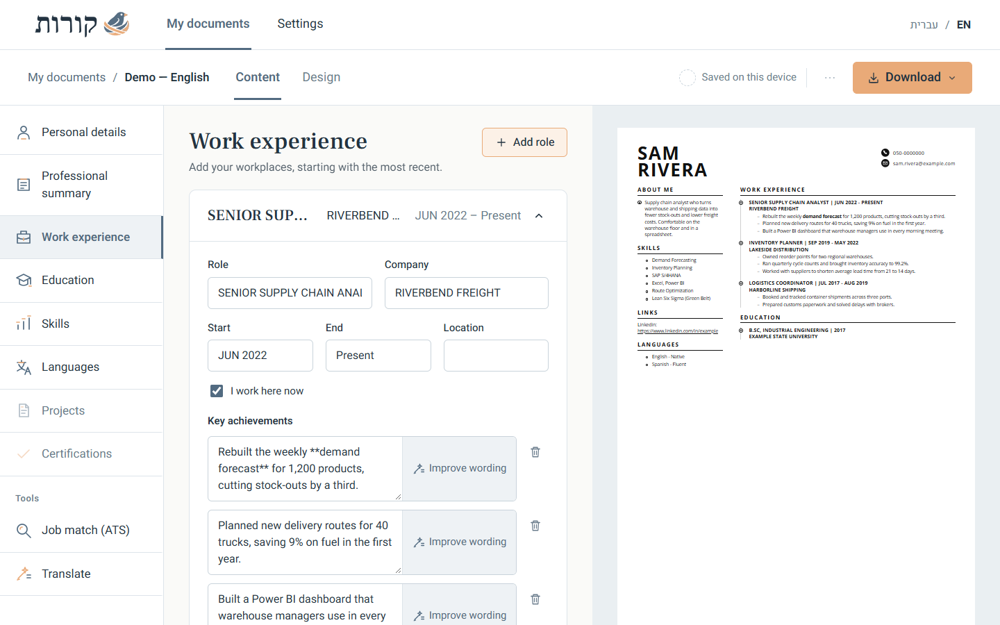
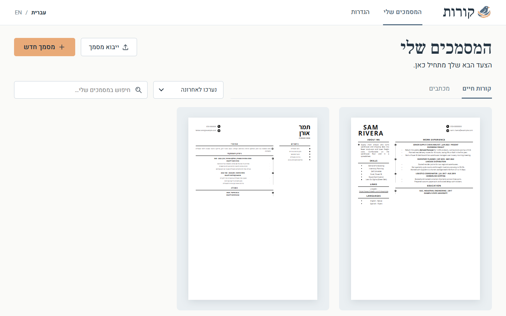

# קורות · Korot

A resume studio that runs in the browser. Write your CV in **English or Hebrew**, see it update live as a real A4 page, check it against a job ad with an **ATS score**, and download it as PDF or Word.

It also writes cover letters and resignation letters. No account, no subscription.

**Why:** most resume builders lock the good templates behind a subscription, handle Hebrew badly, and keep your data on their servers. This one runs entirely in the browser, speaks both languages properly and still gives you an ATS check and AI help with your own key.



## What it does

### Your documents
- A gallery of every CV and letter with a large page preview, the language of each CV, and when it was last edited.
- Search, sort by last edit or by name, and separate tabs for CVs and letters.
- Start a new document, or **import the CV you already have** (paste it as text and AI sorts it into the fields).

### The editor
- A menu of sections on one side, the form for one section in the middle, and the CV itself on the other side, updating as you type.
- **Content** and **Design** are separate tabs, so writing and styling never get in each other’s way.
- AI wording suggestions appear next to the text with *Replace* and *Cancel*; nothing changes until you accept.
- On a phone, the form and the CV preview are two tabs.

### Live editor and templates
- Six templates: **Perth** (two-column timeline), **Classic** (single column, ATS-safe), **Sidebar** (room for a photo), **Editorial**, **Compact** and **Aurora**.
- Accent colours, title and body fonts, optional photo.
- Reorder, rename or hide any section.
- The page shrinks the text to fit a **single A4 page**, so the CV never spills onto a second page.
- **Large preview** with zoom (Fit, 100–150%) to check every line before you download.

### English and Hebrew
- One click switches a CV between English and Hebrew. Hebrew gets a proper **right-to-left** layout, the sidebar on the right, Hebrew section titles and a Hebrew font.
- English and Hebrew versions are separate documents, so each can be tuned on its own.
- The app's own interface is also available in English or Hebrew.
- AI translation turns a CV into any other language.



### ATS check against a job ad
Paste the job description and the tool tells you how well the CV matches it:
- **Instant keyword scan**: which keywords from the ad are in your CV and which are missing.
- **AI ATS score (0–100)** with a verdict: *Recommended to apply*, *Can apply* or *Improve first*. You also get the matched and missing keywords and concrete suggestions.
- **Add missing skills** puts the missing keywords into your skills section in one click.

### AI helpers
- Rewrite the summary, tailored to the job you are applying for.
- Rewrite a single bullet, or suggest new bullets for a role.
- **Improve an existing CV**: paste your current CV as text and it is sorted into the editor's fields.
- Generate cover letters and resignation letters.

AI is optional. In **Settings** paste an API key: Anthropic (Claude) or any OpenAI-compatible provider. Your key is stored only in your browser. Requests to Anthropic go through a small same-origin relay (`/anthropic-api`) because the browser cannot call the API directly; the relay does not store the key.

### Export
PDF (exactly what you see in the preview), Word (.docx) and plain text (.txt).

## Your data

CVs are saved in your browser, so nothing is uploaded unless you set it up. The hosted instance also syncs your resumes through a small document-store API on the host, so the same data appears on every device; the public build works without it.

## Built with

React 19, TypeScript and Vite. `docx` for Word files, `jsPDF` and `html2canvas` for PDF. Interface fonts are Heebo and Frank Ruhl Libre (SIL Open Font License), served with the app.

## Run it yourself

```bash
npm install
npm run dev       # dev server (pins a fixed port; open the address the command prints)
npm run build     # type-check and build into dist/
npm run preview   # serve the built dist/ locally
```

## Deploy

Push to `main`. A GitHub Action builds the static site and copies `dist/` to a Caddy site on a small VPS (`deploy/cv.caddy`). The hosted instance is private, behind a shared Google sign-in.
